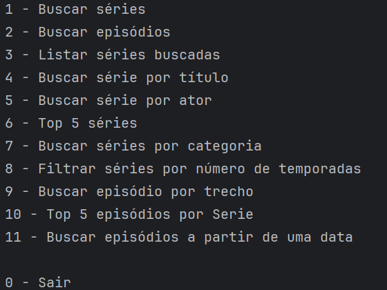
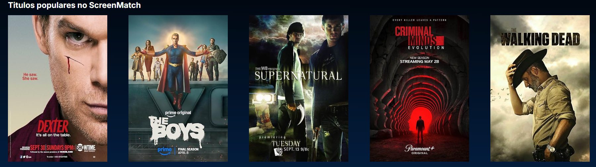

# 🎬 ScreenMatch

Aplicação de catálogo de séries desenvolvida durante os estudos da **Carreira Desenvolvedor Java (Back-end)** da Alura.

Ela busca os dados das séries na **OMDb API**, traduz a sinopse para português com a **API do Gemini**, salva tudo em um banco **PostgreSQL** e disponibiliza as informações de duas formas: por um **menu no console** e por uma **API REST**, que alimenta um front-end fornecido pelo curso.

> O front-end usado nos estudos é material do curso e **não está incluído** neste repositório.

## 🛠 Tecnologias

- Java 25
- Spring Boot 4.1.0 (Spring Web)
- Spring Data JPA
- PostgreSQL
- Jackson (conversão de JSON)
- Google GenAI SDK (Gemini)
- Maven

## ✅ Funcionalidades

Dados obtidos para cada série: título, temporadas, avaliação, gênero, pôster, atores e sinopse (traduzida para português).

### Menu no console

```
1  - Buscar séries
2  - Buscar episódios
3  - Listar séries buscadas
4  - Buscar série por título
5  - Buscar série por ator
6  - Top 5 séries
7  - Buscar séries por categoria
8  - Filtrar séries por número de temporadas
9  - Buscar episódio por trecho
10 - Top 5 episódios por série
11 - Buscar episódios a partir de uma data
0  - Sair
```

### API REST

| Método | Rota | Descrição |
|--------|------|-----------|
| GET | `/series` | Lista todas as séries |
| GET | `/series/top5` | Top 5 séries |
| GET | `/series/lancamentos` | Lançamentos recentes |
| GET | `/series/{id}` | Detalhes de uma série |
| GET | `/series/categoria/{nomeGenero}` | Séries de uma categoria |
| GET | `/series/{id}/temporadas/todas` | Episódios de todas as temporadas |
| GET | `/series/{id}/temporadas/{numero}` | Episódios de uma temporada |
| GET | `/series/{id}/temporadas/top` | Top 5 episódios da série |

## 🔎 Consultas com Spring Data JPA

O `SerieRepository` combina dois tipos de consulta:

- **Consultas derivadas (pelo nome do método):** busca por título (ignorando maiúsculas e minúsculas), por ator com avaliação mínima, top 5 por avaliação, por gênero e por número máximo de temporadas com avaliação mínima.
- **Consultas JPQL (`@Query`):** busca de episódios por trecho do título, top 5 episódios de uma série, episódios a partir de um ano, episódios de uma temporada e os 5 lançamentos mais recentes.

## 🧱 Organização do projeto

```
br.com.alura.screenmatch
├── config       # configuração de CORS
├── controller   # endpoints REST
├── dto          # objetos de saída da API (SerieDTO, EpisodioDTO)
├── model        # entidades e records (Serie, Episodio, Categoria, ...)
├── principal    # menu no console
├── repository   # acesso ao banco (Spring Data JPA)
└── service      # regras de negócio, consumo de APIs e tradução
```

Existem duas classes de execução:

- `ScreenmatchApplication`: sobe a API web.
- `ScreenmatchApplicationSemWeb`: executa o menu no console.

## 🔐 Boas práticas aplicadas

- Arquitetura em camadas (controller, service, repository)
- DTOs para entrada e saída de dados
- Chaves de API e credenciais do banco lidas de **variáveis de ambiente**, sem nenhum segredo no código

## 🚀 Como executar

### Pré-requisitos

- Java 25
- Maven (ou o wrapper `mvnw` do projeto)
- PostgreSQL
- Chave da [OMDb API](https://www.omdbapi.com/apikey.aspx)
- Chave da API do Gemini (gerada no [Google AI Studio](https://aistudio.google.com/))

### 1. Clone o repositório

```bash
git clone https://github.com/Luana-Ferreira-dev/screenmatch.git
cd screenmatch
```

### 2. Crie o banco de dados

Crie um banco no PostgreSQL (por exemplo, `screenmatch`). As tabelas são criadas automaticamente na primeira execução (`spring.jpa.hibernate.ddl-auto=update`).

### 3. Configure as variáveis de ambiente

| Variável | Descrição |
|----------|-----------|
| `SM_HOST` | Host e porta do PostgreSQL (ex.: `localhost:5432`) |
| `BD_NAME` | Nome do banco de dados |
| `BD_USER` | Usuário do banco |
| `BD_PASSWORD` | Senha do banco |
| `OMDB_API_KEY` | Chave da OMDb API |
| `GEMINI_API_KEY` | Chave da API do Gemini |

No IntelliJ: **Run → Edit Configurations → Environment variables** (configure para as duas classes de execução).

### 4. Execute

- **API web:** execute a classe `ScreenmatchApplication`.
- **Menu no console:** execute a classe `ScreenmatchApplicationSemWeb`.

## 📸 Imagens





## 👩‍💻 Autora

**Luana Ferreira**
[LinkedIn](https://www.linkedin.com/in/luana-ferreira-dev) · [GitHub](https://github.com/Luana-Ferreira-dev)

---

Projeto desenvolvido para fins de estudo na Carreira Java da Alura. Dados de séries fornecidos pela OMDb API.
